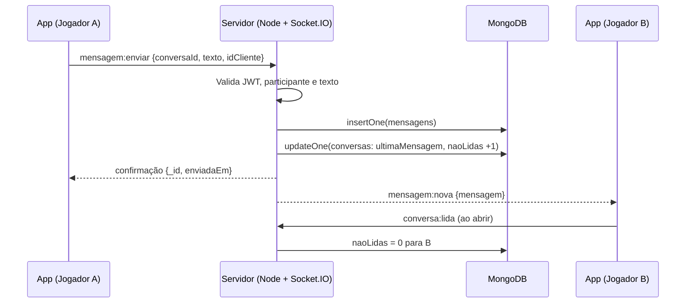

# PRD — BoraPelada

> **Documento de Requisitos do Produto (Product Requirements Document)**
> Versão 1.1 · Novembro de 2026 · MVP implementado (ver [README](../README.md) para rodar o projeto)

| Item | Informação |
|---|---|
| Projeto | BoraPelada: app para organizar peladas de futebol amador |
| Curso | Ciência da Computação, Centro Universitário de Maceió (UNIMA/Afya) |
| Integrantes | Bernardo Torres de Souza e Kaue Cavalcante |
| Repositório | <https://github.com/bernardots23/borapelada> |
| GitHub Project | <https://github.com/users/bernardots23/projects/2> |

---

## Sumário

1. [Visão do produto](#1-visão-do-produto)
2. [Escopo](#2-escopo)
3. [Requisitos](#3-requisitos)
4. [Gerência do projeto](#4-gerência-do-projeto)
5. [Funcionalidade de conversa com NoSQL](#5-funcionalidade-de-conversa-com-nosql)
6. [Apêndice](#6-apêndice)

---

## 1. Visão do produto

### 1.1 Nome do projeto

**BoraPelada** é um aplicativo web responsivo, que também funciona no celular, para criar grupos de pelada, marcar jogos, confirmar presença, sortear times e conversar com os outros jogadores.

### 1.2 Problema identificado

Toda semana, milhares de grupos de amigos jogam pelada (futebol society, futsal ou de campo). Hoje a organização é feita quase sempre em grupos de WhatsApp e listas copiadas e coladas, e isso causa problemas que se repetem:

- **Lista de presença bagunçada.** O organizador copia e cola a lista ("1. Fulano, 2. Ciclano...") dezenas de vezes. Nomes somem, a ordem se perde e ninguém sabe quem está confirmado ou na espera.
- **Faltas de última hora.** Quem desiste não avisa direito. O jogo fica com poucos jogadores e quem estava na espera não fica sabendo que abriu vaga.
- **Informação perdida no meio da conversa.** Horário, local e valor da quadra se perdem no meio de memes e conversas paralelas do grupo geral.
- **Times desequilibrados.** A escolha de times na hora gera discussão e partidas sem graça.
- **Sobrecarga do organizador.** Uma pessoa só faz tudo: marca a quadra, cobra, monta a lista e divide os times.

O problema não é a falta de um app. O problema é que **o organizador perde tempo e os jogos ficam incompletos ou desequilibrados** porque presença, informações do jogo e conversa estão misturadas no mesmo lugar.

### 1.3 Público-alvo

| Persona | Descrição | Necessidade principal |
|---|---|---|
| **Organizador** | Pessoa que cria e administra o grupo da pelada. Marca a quadra e controla a lista. Geralmente de 20 a 40 anos. | Montar a lista e fechar os times rápido, sem copiar e colar. |
| **Jogador** | Participante fixo ou eventual do grupo. | Saber quando e onde é o jogo, confirmar presença com um toque e falar com o grupo. |
| **Jogador da lista de espera** | Quer jogar, mas as vagas estão cheias. | Ser avisado na hora em que uma vaga abrir. |

Recorte inicial: grupos de pelada de **Maceió/AL**, com 10 a 30 membros, que jogam uma ou duas vezes por semana.

### 1.4 Objetivos

| # | Objetivo | Métrica / meta mensurável |
|---|---|---|
| O1 | Reduzir o tempo do organizador para fechar a lista de um jogo | Lista fechada em **menos de 5 minutos** de trabalho do organizador (hoje leva de 20 a 30 minutos, segundo relatos de organizadores) |
| O2 | Diminuir jogos com jogadores a menos | Pelo menos **80%** dos jogos criados com o número mínimo de confirmados até 2 horas antes do início |
| O3 | Tornar a conversa do grupo útil para a pelada | Pelo menos **60%** dos grupos ativos trocam mensagens pelo chat do app na semana do jogo |

### 1.5 Benefícios esperados

- **Para o organizador:** lista automática, com vagas e espera controladas sem trabalho manual.
- **Para o jogador:** todas as informações do jogo em uma tela e confirmação com um toque.
- **Para o grupo:** uma conversa própria da pelada, separada do grupo geral de WhatsApp, e times sorteados de forma equilibrada.

---

## 2. Escopo

### 2.1 Funcionalidades previstas (visão completa do produto)

1. Cadastro e login de usuários.
2. Criação e gestão de grupos de pelada.
3. Convite de membros por link.
4. Criação de jogos (data, hora, local, vagas, valor).
5. Confirmação de presença com lista de espera automática.
6. Sorteio de times equilibrado por nível do jogador.
7. **Chat do grupo e chat privado entre membros (NoSQL).**
8. Notificações (vaga aberta, jogo amanhã, nova mensagem).
9. Controle de pagamento da quadra (quem pagou e quem não pagou).
10. Avaliação dos jogadores após o jogo e ranking do grupo.
11. Integração com pagamento via Pix.
12. Busca de peladas abertas na cidade.

### 2.2 Primeira versão (MVP)

O MVP inclui somente o necessário para um grupo organizar uma pelada inteira pelo app:

| Funcionalidade | Prioridade | Observação |
|---|---|---|
| Cadastro e login (e-mail e senha) | P0 | |
| Criar grupo e convidar por link | P0 | |
| Criar jogo com vagas e lista de espera | P0 | |
| Confirmar e cancelar presença | P0 | Promove automaticamente o primeiro da espera |
| Chat do grupo | P0 | Requisito obrigatório da disciplina |
| Chat privado entre membros do mesmo grupo | P0 | Requisito obrigatório da disciplina |
| Sorteio de times por nível (1 a 5 estrelas) | P1 | Nível definido pelo organizador |
| Notificação no app (vaga aberta e nova mensagem) | P1 | Sem push nativo no MVP |
| Controle simples de pagamento (marcar quem pagou) | P2 | Fica no MVP se houver tempo |

### 2.3 Fora do escopo desta entrega

- Pagamento real dentro do app (Pix ou cartão).
- Aplicativo nativo Android/iOS e notificações push. O MVP é web responsivo.
- Avaliação dos jogadores, ranking e estatísticas.
- Busca pública de peladas e reserva de quadras.
- Envio de fotos, áudios e arquivos no chat. O MVP aceita só texto.
- Edição de mensagens e indicador de "digitando".

---

## 3. Requisitos

### 3.1 Requisitos funcionais

| ID | Requisito | Prioridade |
|---|---|---|
| RF01 | O sistema deve permitir cadastro com nome, e-mail, senha e posição preferida. | P0 |
| RF02 | O sistema deve permitir login e logout com e-mail e senha. | P0 |
| RF03 | O usuário deve poder criar um grupo de pelada e se tornar o organizador. | P0 |
| RF04 | O organizador deve poder gerar um link de convite para o grupo. | P0 |
| RF05 | Um usuário logado deve poder entrar no grupo pelo link de convite. | P0 |
| RF06 | O organizador deve poder remover membros do grupo. | P0 |
| RF07 | O organizador deve poder criar um jogo com data, hora, local, número de vagas e valor por pessoa. | P0 |
| RF08 | O membro deve poder confirmar presença em um jogo. Se as vagas estiverem cheias, ele entra na lista de espera. | P0 |
| RF09 | O membro deve poder cancelar a presença. O primeiro da lista de espera é promovido automaticamente. | P0 |
| RF10 | O sistema deve mostrar a lista de confirmados e de espera em ordem de confirmação. | P0 |
| RF11 | O membro deve poder enviar e ler mensagens no chat do grupo. | P0 |
| RF12 | O membro deve poder iniciar uma conversa privada com outro membro do mesmo grupo. | P0 |
| RF13 | O sistema deve mostrar o histórico de mensagens em ordem cronológica, com carregamento das mensagens mais antigas sob demanda. | P0 |
| RF14 | O sistema deve mostrar a lista de conversas do usuário ordenada pela mensagem mais recente, com contador de não lidas. | P0 |
| RF15 | O organizador deve poder atribuir um nível de 1 a 5 a cada membro. | P1 |
| RF16 | O organizador deve poder sortear times equilibrados entre os confirmados. | P1 |
| RF17 | O sistema deve notificar no app quando uma vaga abrir ou uma nova mensagem chegar. | P1 |
| RF18 | O organizador deve poder marcar quem pagou o jogo. | P2 |

### 3.2 Requisitos não funcionais

| ID | Categoria | Requisito |
|---|---|---|
| RNF01 | Desempenho | Uma mensagem enviada deve aparecer para os outros participantes conectados em até **2 segundos** em uma conexão 4G. |
| RNF02 | Desempenho | O histórico deve carregar em páginas de **30 mensagens**, em até 1 segundo por página. |
| RNF03 | Segurança | As senhas devem ser armazenadas com hash (bcrypt). Toda comunicação deve usar HTTPS/WSS. |
| RNF04 | Segurança | Toda rota da API, exceto cadastro e login, deve exigir um token JWT válido. |
| RNF05 | Privacidade (LGPD) | O usuário deve poder excluir a conta. Os dados pessoais são removidos e as mensagens passam a aparecer como "Usuário removido". |
| RNF06 | Usabilidade | A interface deve ser responsiva e utilizável em telas a partir de 360 px de largura. |
| RNF07 | Usabilidade | Confirmar presença deve levar no máximo **2 toques** a partir da tela inicial. |
| RNF08 | Disponibilidade | O sistema deve rodar localmente com um único comando (Docker Compose) e poder ser publicado em serviços gratuitos (MongoDB Atlas M0, Render), com meta de 99% de disponibilidade no período de uso. |
| RNF09 | Manutenibilidade | O código deve ficar no GitHub, com revisão por Pull Request e README de instalação. |
| RNF10 | Escalabilidade | O modelo de dados do chat deve suportar grupos de até 100 membros e conversas com mais de 10 mil mensagens sem perda de desempenho na consulta (uso de índices). |

### 3.3 Histórias de usuário e critérios de aceitação

Os critérios seguem o formato **Dado / Quando / Então** para que possam ser testados.

---

**HU01: Criar grupo** *(RF03, RF04)*
> Como **organizador**, quero criar um grupo de pelada e gerar um link de convite para que meus amigos entrem sem eu ter que cadastrar um por um.

- **CA01.1:** Dado que estou logado, quando informo um nome de grupo com 3 a 50 caracteres e confirmo, então o grupo é criado e eu apareço como organizador.
- **CA01.2:** Dado que sou organizador, quando clico em "Gerar convite", então recebo um link único válido por 7 dias.
- **CA01.3:** Dado que informei um nome com menos de 3 caracteres, quando tento criar o grupo, então vejo a mensagem "O nome precisa ter pelo menos 3 caracteres" e o grupo não é criado.

---

**HU02: Entrar no grupo** *(RF05)*
> Como **jogador**, quero entrar no grupo pelo link que recebi para acompanhar os jogos.

- **CA02.1:** Dado um link de convite válido e que estou logado, quando abro o link, então entro como membro e o grupo aparece na minha tela inicial.
- **CA02.2:** Dado um link expirado, quando abro o link, então vejo "Convite expirado, peça um novo ao organizador".
- **CA02.3:** Dado que já sou membro, quando abro o link de novo, então sou levado ao grupo sem ser adicionado duas vezes.

---

**HU03: Criar jogo** *(RF07)*
> Como **organizador**, quero criar um jogo com data, local e vagas para que o grupo saiba quando é a pelada.

- **CA03.1:** Dado que preenchi data futura, hora, local e vagas (entre 4 e 40), quando salvo, então o jogo aparece para todos os membros do grupo.
- **CA03.2:** Dado que informei uma data no passado, quando salvo, então vejo um erro e o jogo não é criado.
- **CA03.3:** Dado que o jogo foi criado, então uma mensagem automática do sistema é enviada no chat do grupo com data, hora e local.

---

**HU04: Confirmar presença e lista de espera** *(RF08, RF10)*
> Como **jogador**, quero confirmar minha presença com um toque e saber se estou dentro ou na espera.

- **CA04.1:** Dado um jogo com 14 vagas e 13 confirmados, quando confirmo, então fico na posição 14 da lista de confirmados.
- **CA04.2:** Dado um jogo com 14 vagas e 14 confirmados, quando confirmo, então entro na posição 1 da lista de espera e vejo o aviso "Você está na espera (1º)".
- **CA04.3:** Dado que já confirmei, quando tento confirmar de novo, então nada muda e meu nome não se repete na lista.
- **CA04.4:** Dado que dois jogadores confirmam ao mesmo tempo a última vaga, então apenas um fica com a vaga e o outro vai para a espera.

---

**HU05: Cancelar presença** *(RF09, RF17)*
> Como **jogador**, quero cancelar minha presença para liberar a vaga a outra pessoa.

- **CA05.1:** Dado que estou confirmado e há pessoas na espera, quando cancelo, então o 1º da espera passa para a lista de confirmados.
- **CA05.2:** Dado o cenário do CA05.1, então o jogador promovido recebe a notificação "Abriu vaga! Você está confirmado no jogo de [data]".
- **CA05.3:** Dado que cancelei, então a lista exibida para todos é atualizada em até 2 segundos.

---

**HU06: Sortear times** *(RF15, RF16)*
> Como **organizador**, quero sortear times equilibrados para evitar discussão e jogos desiguais.

- **CA06.1:** Dado 14 confirmados e a opção "2 times", quando clico em "Sortear", então são gerados 2 times de 7 jogadores.
- **CA06.2:** Dado que todos têm nível atribuído, então o sistema escolhe a divisão com a **menor diferença possível** entre a soma dos níveis dos times. Exemplo: com 14 jogadores de níveis 5, 5, 4, 4, 4, 3, 3, 3, 3, 2, 2, 2, 1 e 1, a diferença fica em no máximo 2 pontos.
  > *Ajuste da v1.1:* a meta fixa de "no máximo 2 pontos" não é possível em alguns grupos. Por exemplo, com três jogadores nível 5 e sete nível 1, a menor diferença possível é 3. Por isso o critério passou a ser "a menor diferença possível", verificado por teste automático contra uma busca exaustiva.
- **CA06.3:** Dado que o número de confirmados não divide igualmente, então a diferença de jogadores entre os times é de no máximo 1.

---

**HU07: Conversar no grupo** *(RF11, RF13)*
> Como **membro**, quero conversar com o grupo no app para combinar detalhes da pelada sem misturar com o grupo geral.

*(Critérios detalhados na seção 5.5.)*

---

**HU08: Conversar no privado** *(RF12, RF14)*
> Como **jogador**, quero mandar uma mensagem privada para outro membro, por exemplo para combinar uma carona ou acertar o pagamento.

*(Critérios detalhados na seção 5.5.)*

---

## 4. Gerência do projeto

### 4.1 Integrantes e responsabilidades

| Integrante | Papel | Responsabilidades |
|---|---|---|
| Bernardo Torres de Souza | Product Owner, Documentação e Front-end/UX | Redação e atualização do PRD, priorização do backlog, organização do GitHub Project, protótipo das telas, interface web responsiva e roteiro de testes |
| Kaue Cavalcante | Back-end, Banco de dados e Chat | API REST, autenticação, regras de presença e lista de espera, modelagem NoSQL (MongoDB), servidor de chat com Socket.IO, índices, regras de acesso e deploy |

> Como o grupo tem dois integrantes, um revisa os Pull Requests do outro. Cada PR precisa da aprovação do colega antes do merge. Assim, os dois conhecem todas as partes do sistema.

### 4.2 Stack prevista

| Camada | Tecnologia |
|---|---|
| Front-end | React + Vite (web responsivo) |
| Back-end | Node.js + Express |
| Tempo real | Socket.IO (WebSocket) |
| Banco de dados | MongoDB (MongoDB Atlas, plano gratuito M0) |
| Autenticação | JWT + bcrypt |
| Execução / hospedagem | Local com Docker Compose (MongoDB + app). Opcional: Render + MongoDB Atlas |
| Gestão | GitHub Issues + GitHub Projects |
| Testes | `node:test` (unitários e integração) + GitHub Actions com MongoDB |

### 4.3 Backlog priorizado

| # | Item do backlog | Prioridade | Responsável | Etapa |
|---|---|---|---|---|
| 1 | Escrever e publicar o PRD em `docs/PRD.md` | P0 | Bernardo | 1 |
| 2 | Criar repositório, README e GitHub Project | P0 | Bernardo | 1 |
| 3 | Protótipo das telas principais (Figma) | P0 | Bernardo | 1 |
| 4 | Modelagem do banco NoSQL (coleções e índices) | P0 | Kaue | 1 |
| 5 | Configurar projeto base (front, back e MongoDB Atlas) | P0 | Kaue | 2 |
| 6 | Cadastro e login com JWT (RF01, RF02) | P0 | Kaue | 2 |
| 7 | Criar grupo e convite por link (RF03 a RF06) | P0 | Kaue | 2 |
| 8 | Criar jogo (RF07) | P0 | Kaue | 2 |
| 9 | Presença e lista de espera (RF08 a RF10) | P0 | Kaue | 2 |
| 10 | Telas de grupo, jogo e lista | P0 | Bernardo | 2 |
| 11 | Servidor de chat com Socket.IO | P0 | Kaue | 3 |
| 12 | Chat do grupo: envio e histórico paginado (RF11, RF13) | P0 | Kaue | 3 |
| 13 | Chat privado (RF12) | P0 | Kaue | 3 |
| 14 | Lista de conversas e contador de não lidas (RF14) | P0 | Kaue | 3 |
| 15 | Tela do chat | P0 | Bernardo | 3 |
| 16 | Nível dos jogadores e sorteio de times (RF15, RF16) | P1 | Kaue | 4 |
| 17 | Notificações no app (RF17) | P1 | Kaue | 4 |
| 18 | Testes dos critérios de aceitação | P1 | Ambos | 4 |
| 19 | Configuração local com Docker Compose (e deploy opcional) | P1 | Kaue | 4 |
| 20 | Controle de pagamento (RF18) | P2 | Bernardo | 4 |

### 4.4 Etapas e prazos

| Etapa | Período | Entregas |
|---|---|---|
| **1. Planejamento** | 24/11/2026 a 30/11/2026 | PRD, repositório, GitHub Project, protótipo e modelagem do banco *(entrega atual)* |
| **2. Base e jogos** | 01/12/2026 a 14/12/2026 | Login, grupos, convites, jogos, presença e lista de espera |
| **3. Chat (NoSQL)** | 15/12/2026 a 28/12/2026 | Chat do grupo, chat privado, histórico e não lidas |
| **4. Finalização** | 29/12/2026 a 11/01/2027 | Sorteio de times, notificações, testes, deploy e apresentação |

> As datas a partir da Etapa 2 são uma proposta e podem ser ajustadas ao calendário da disciplina.

### 4.5 Dependências

| Item | Depende de |
|---|---|
| Cadastro e login (6) | Projeto base configurado (5) |
| Grupos (7) | Login (6) |
| Jogos (8) | Grupos (7) |
| Presença e espera (9) | Jogos (8) |
| Chat do grupo (12) | Grupos (7), modelagem NoSQL (4), servidor Socket.IO (11) |
| Chat privado (13) | Chat do grupo (12) |
| Sorteio de times (16) | Presença (9) |
| Notificações (17) | Presença (9) e chat (12) |
| Externas | Docker Desktop (execução local); MongoDB Atlas e Render, se houver deploy |

### 4.6 Riscos e mitigação

| Risco | Probabilidade | Impacto | Estratégia |
|---|---|---|---|
| Atraso por excesso de escopo | Alta | Alto | Priorização P0/P1/P2. Itens P2 são cortados primeiro. |
| Pouca experiência do grupo com WebSocket ou NoSQL | Média | Alto | Fazer uma prova de conceito do chat logo no início da Etapa 3. Usar a documentação oficial do MongoDB e do Socket.IO. |
| Grupo pequeno (2 integrantes) e um deles indisponível em algum período (provas, estágio, TCC) | Alta | Alto | Revisão cruzada de PRs, para que os dois conheçam todo o código. Itens P1/P2 são cortados antes de atrasar os P0. Se o back-end atrasar, Bernardo assume tarefas de front-end que não dependem da API, usando dados simulados (mock). |
| Limites do plano gratuito (Atlas M0: 512 MB) | Baixa | Médio | Mensagens só de texto e índices enxutos. O uso é monitorado no painel do Atlas. |
| Condição de corrida na última vaga | Média | Médio | Atualização atômica no MongoDB (`findOneAndUpdate` com condição de vagas). |
| Conflitos de código (merge) | Média | Baixo | Uma branch por issue e PRs pequenos. |

### 4.7 Acompanhamento das atividades

- **GitHub Project** em quadro (Board) com as colunas **A fazer**, **Em andamento**, **Em revisão** e **Concluído**.
- Cada item do backlog vira uma **issue** com responsável (assignee), rótulo de prioridade (`P0`, `P1`, `P2`), rótulo de área (`docs`, `backend`, `frontend`, `chat`, `banco`) e marco (milestone) da etapa.
- Cada Pull Request referencia a issue (`Closes #N`). Quando o PR é aceito, a issue vai para **Concluído**.
- **Reunião semanal de 15 minutos**: o que foi feito, o que será feito e o que está travando.
- Uma issue parada há mais de 5 dias em "Em andamento" é discutida na reunião.

---

## 5. Funcionalidade de conversa com NoSQL

### 5.1 Quem pode conversar

| Tipo de conversa | Participantes | Quem pode iniciar |
|---|---|---|
| **Chat do grupo** | Todos os membros do grupo de pelada | Criado automaticamente junto com o grupo |
| **Chat privado** | Exatamente 2 usuários que são membros de pelo menos um grupo em comum | Qualquer um dos dois |

- Não é possível mandar mensagem para quem não divide nenhum grupo com você. Isso evita spam de desconhecidos.
- Mensagens do **sistema**, como "Jogo marcado para sábado, 16h" ou "Fulano entrou no grupo", são publicadas automaticamente no chat do grupo.

### 5.2 Como as conversas são iniciadas e como as mensagens circulam

**Início da conversa**

1. **Grupo:** quando o grupo é criado (RF03), o back-end cria também um documento de conversa do tipo `grupo`. Quando um membro entra ou sai, a lista de participantes é atualizada.
2. **Privado:** o usuário abre o perfil de outro membro e toca em "Mandar mensagem". O back-end procura uma conversa `privada` entre os dois. Se ela existir, é reaberta; se não existir, é criada. Assim, nunca há duas conversas privadas entre as mesmas pessoas.

**Envio**

1. O cliente envia a mensagem pelo Socket.IO (evento `mensagem:enviar`) com `conversaId`, `texto` e um `idCliente` (UUID gerado no aparelho).
2. O servidor valida o token JWT, confirma que o remetente é participante e verifica o texto (de 1 a 2000 caracteres, sem ser só espaços).
3. A mensagem é gravada na coleção `mensagens` com a data e hora do **servidor**.
4. A conversa recebe `ultimaMensagem` e `atualizadaEm`, e o contador de não lidas dos outros participantes é incrementado.
5. O servidor emite `mensagem:nova` para a sala (room) da conversa, e todos os participantes conectados recebem a mensagem na hora.
6. O `idCliente` evita duplicidade: se a internet cair e o cliente reenviar, o índice único impede a gravação repetida.

**Consulta**

- **Lista de conversas:** `GET /conversas` devolve as conversas do usuário ordenadas por `atualizadaEm` decrescente, com prévia da última mensagem e número de não lidas.
- **Histórico:** `GET /conversas/:id/mensagens?antesDe=<cursor>&limite=30` devolve as 30 mensagens anteriores ao cursor (paginação por cursor, sem `skip`).
- **Marcar como lida:** ao abrir a conversa, o cliente envia `conversa:lida`, e o contador do usuário volta para 0.

**Armazenamento**

As mensagens ficam em uma coleção separada, um documento por mensagem, e não dentro do documento da conversa. Assim, uma conversa longa nunca ultrapassa o limite de 16 MB por documento do MongoDB, e a paginação fica rápida usando índices.

### 5.3 Banco NoSQL escolhido: MongoDB

**Escolha:** MongoDB (banco orientado a documentos), hospedado no MongoDB Atlas.

**Justificativa:**

| Critério | Por que o MongoDB atende |
|---|---|
| Formato dos dados | Mensagens e conversas são naturalmente documentos JSON. Mensagens de sistema e de usuário podem ter campos diferentes sem alterar um esquema. |
| Escrita frequente | O chat gera muitas inserções pequenas. O MongoDB lida bem com alto volume de inserts. |
| Consulta com ordenação | O índice composto `{ conversaId, enviadaEm }` permite buscar e ordenar o histórico de uma conversa de forma eficiente e paginada. |
| Atualizações atômicas | Operadores como `$inc` e `$set` atualizam contadores de não lidas e a última mensagem sem condição de corrida. |
| Integração com a stack | Funciona nativamente com Node.js (driver oficial / Mongoose), usando o mesmo formato JSON do front-end. |
| Custo e aprendizado | O plano gratuito do Atlas (M0) é suficiente para o projeto. O banco é muito documentado e usado no mercado. |

**Alternativas consideradas:**

- **Firebase Firestore:** tem tempo real embutido, mas prende o projeto ao Google, tem um modelo de cobrança por leitura e dá menos liberdade nas consultas.
- **Redis:** é ótimo para tempo real, mas é um banco em memória e não é o ideal para guardar o histórico de forma permanente. Pode ser usado no futuro como camada de cache e pub/sub.
- **Cassandra:** escala muito bem, mas é complexo demais para o tamanho do projeto.

### 5.4 Organização dos dados

O banco do chat usa três coleções: `usuarios`, `conversas` e `mensagens`. Os dados de grupos e jogos também ficam no MongoDB, mas aqui é mostrada só a parte do chat.

#### Coleção `usuarios` (resumida)

```json
{
  "_id": "6740a1f2c3b4a5d6e7f80001",
  "nome": "Bernardo Torres",
  "email": "bernardo@email.com",
  "senhaHash": "$2b$10$...",
  "posicao": "meia",
  "gruposIds": ["6740a1f2c3b4a5d6e7f8a001"],
  "criadoEm": "2026-11-20T18:00:00Z"
}
```

#### Coleção `conversas`

Conversa de **grupo**:

```json
{
  "_id": "6740b2e3d4c5b6a7f8090101",
  "tipo": "grupo",
  "grupoId": "6740a1f2c3b4a5d6e7f8a001",
  "titulo": "Pelada de Quinta - Society Ponta Verde",
  "participantes": [
    { "usuarioId": "6740a1f2c3b4a5d6e7f80001", "papel": "organizador", "entrouEm": "2026-11-20T18:05:00Z", "naoLidas": 0 },
    { "usuarioId": "6740a1f2c3b4a5d6e7f80002", "papel": "membro", "entrouEm": "2026-11-21T09:12:00Z", "naoLidas": 3 }
  ],
  "participantesIds": ["6740a1f2c3b4a5d6e7f80001", "6740a1f2c3b4a5d6e7f80002"],
  "ultimaMensagem": {
    "texto": "Bora! Levo a bola.",
    "remetenteId": "6740a1f2c3b4a5d6e7f80001",
    "enviadaEm": "2026-11-23T14:02:10Z"
  },
  "criadaEm": "2026-11-20T18:05:00Z",
  "atualizadaEm": "2026-11-23T14:02:10Z"
}
```

Conversa **privada**:

```json
{
  "_id": "6740c3f4e5d6c7b8a9010202",
  "tipo": "privada",
  "chavePrivada": "6740a1f2c3b4a5d6e7f80001_6740a1f2c3b4a5d6e7f80002",
  "participantes": [
    { "usuarioId": "6740a1f2c3b4a5d6e7f80001", "naoLidas": 0 },
    { "usuarioId": "6740a1f2c3b4a5d6e7f80002", "naoLidas": 1 }
  ],
  "participantesIds": ["6740a1f2c3b4a5d6e7f80001", "6740a1f2c3b4a5d6e7f80002"],
  "ultimaMensagem": {
    "texto": "Te dou carona, passo aí 15h40",
    "remetenteId": "6740a1f2c3b4a5d6e7f80001",
    "enviadaEm": "2026-11-23T13:45:00Z"
  },
  "criadaEm": "2026-11-22T20:00:00Z",
  "atualizadaEm": "2026-11-23T13:45:00Z"
}
```

> `chavePrivada` é formada pelos dois IDs em ordem crescente, separados por `_`. Com um índice único nesse campo, é impossível existirem duas conversas privadas entre as mesmas pessoas.

#### Coleção `mensagens`

Mensagem de **usuário**:

```json
{
  "_id": "6741d4a5f6e7d8c9b0120303",
  "conversaId": "6740b2e3d4c5b6a7f8090101",
  "tipo": "usuario",
  "remetenteId": "6740a1f2c3b4a5d6e7f80001",
  "remetenteNome": "Bernardo Torres",
  "texto": "Bora! Levo a bola.",
  "idCliente": "c1f3a9e2-5b7d-4e1a-9c2f-8d6b4a3e1f00",
  "enviadaEm": "2026-11-23T14:02:10Z",
  "excluida": false
}
```

Mensagem de **sistema**:

```json
{
  "_id": "6741d4a5f6e7d8c9b0120304",
  "conversaId": "6740b2e3d4c5b6a7f8090101",
  "tipo": "sistema",
  "evento": "jogo_criado",
  "texto": "Jogo marcado: sábado, 28/11, 16h - Society Ponta Verde. 14 vagas.",
  "dados": { "jogoId": "6741aa00f6e7d8c9b012aaaa" },
  "enviadaEm": "2026-11-23T10:00:00Z"
}
```

> `remetenteNome` é copiado na mensagem (desnormalização) para que o histórico seja exibido sem consultar a coleção `usuarios` a cada mensagem.

#### Índices

| Coleção | Índice | Finalidade |
|---|---|---|
| `mensagens` | `{ conversaId: 1, enviadaEm: -1, _id: -1 }` | Buscar o histórico de uma conversa já ordenado e paginado |
| `mensagens` | `{ conversaId: 1, idCliente: 1 }` único (parcial, só quando `idCliente` existe) | Impedir mensagens duplicadas em reenvios |
| `conversas` | `{ participantesIds: 1, atualizadaEm: -1 }` | Listar as conversas de um usuário, da mais recente para a mais antiga |
| `conversas` | `{ chavePrivada: 1 }` único (parcial) | Garantir uma única conversa privada por par de usuários |
| `conversas` | `{ grupoId: 1 }` único (parcial) | Garantir uma única conversa por grupo |

#### Consultas principais

```js
// Histórico: 30 mensagens anteriores ao cursor, da mais nova para a mais antiga
db.mensagens.find({
  conversaId: ObjectId("6740b2e3d4c5b6a7f8090101"),
  enviadaEm: { $lt: ISODate("2026-11-23T14:02:10Z") }
}).sort({ enviadaEm: -1, _id: -1 }).limit(30)
// O front-end inverte o resultado para exibir da mais antiga (em cima) para a mais nova (embaixo).

// Lista de conversas do usuário
db.conversas.find({ participantesIds: ObjectId("6740a1f2c3b4a5d6e7f80001") })
  .sort({ atualizadaEm: -1 })

// Após gravar uma mensagem: atualizar a conversa e somar não lidas para os outros
db.conversas.updateOne(
  { _id: ObjectId("6740b2e3d4c5b6a7f8090101") },
  {
    $set: { ultimaMensagem: { texto: "...", remetenteId: "...", enviadaEm: new Date() }, atualizadaEm: new Date() },
    $inc: { "participantes.$[outro].naoLidas": 1 }
  },
  { arrayFilters: [{ "outro.usuarioId": { $ne: ObjectId("6740a1f2c3b4a5d6e7f80001") } }] }
)

// Marcar como lida
db.conversas.updateOne(
  { _id: ObjectId("6740b2e3d4c5b6a7f8090101"), "participantes.usuarioId": ObjectId("6740a1f2c3b4a5d6e7f80002") },
  { $set: { "participantes.$.naoLidas": 0 } }
)
```

### 5.5 Regras de acesso às conversas e ao histórico

| # | Regra |
|---|---|
| RA01 | Só usuários autenticados (JWT válido) acessam qualquer rota ou evento do chat. |
| RA02 | Um usuário só lê ou envia mensagens em conversas em que o seu ID está em `participantesIds`. Caso contrário, a API responde **403 Forbidden**. |
| RA03 | Ao entrar em um grupo, o membro é adicionado ao chat do grupo e **pode ver todo o histórico** anterior, para acompanhar o que já foi combinado. |
| RA04 | Ao sair ou ser removido do grupo, o usuário é retirado de `participantesIds` e **perde o acesso** ao chat do grupo, incluindo o histórico. |
| RA05 | Uma conversa privada só pode ser **criada** entre usuários que dividem pelo menos um grupo. Depois de criada, ela continua acessível aos dois mesmo que deixem de dividir grupos, mas não dá mais para enviar mensagens nela. |
| RA06 | O autor pode **excluir a própria mensagem**. Ela continua no histórico como "Mensagem apagada" (`excluida: true`, texto removido). O organizador pode excluir qualquer mensagem do chat do grupo (moderação). |
| RA07 | Ninguém, nem o organizador, tem acesso a conversas privadas de que não participa. |
| RA08 | A data e hora da mensagem é sempre definida pelo **servidor**. O cliente não consegue alterar a ordem do histórico. |
| RA09 | Limite de **20 mensagens por minuto** por usuário, para evitar spam. Acima disso, o envio é recusado com aviso. |
| RA10 | Quando a conta é excluída (LGPD), o nome nas mensagens antigas passa a ser "Usuário removido". |

### 5.6 Critérios de aceitação do chat

**Envio**

- **CA-C01:** Dado que sou membro do grupo, quando envio "Bora!", então a mensagem é gravada na coleção `mensagens` com `conversaId`, `remetenteId`, `texto` e `enviadaEm`, e aparece para os outros membros conectados em até 2 segundos.
- **CA-C02:** Dado que tento enviar uma mensagem vazia ou só com espaços, então o envio é bloqueado e nada é gravado.
- **CA-C03:** Dado que tento enviar um texto com mais de 2000 caracteres, então vejo o erro "Mensagem muito longa (máx. 2000 caracteres)" e nada é gravado.
- **CA-C04:** Dado que **não** sou participante da conversa, quando tento enviar uma mensagem (via API ou socket), então recebo erro 403 e nada é gravado.
- **CA-C05:** Dado que minha conexão caiu e o app reenviou a mesma mensagem (mesmo `idCliente`), então ela aparece **uma única vez** no histórico.
- **CA-C06:** Dado que enviei uma mensagem, então a conversa fica no topo da lista de conversas de todos os participantes e o contador de não lidas dos outros aumenta em 1.

**Consulta**

- **CA-C07:** Dado uma conversa com 100 mensagens, quando a abro, então vejo as **30 mais recentes** e a tela rola até a última.
- **CA-C08:** Dado que estou vendo as 30 mais recentes, quando rolo até o topo, então as 30 anteriores são carregadas sem repetir nem pular nenhuma mensagem.
- **CA-C09:** Dado que cheguei à primeira mensagem da conversa, quando rolo até o topo, então vejo "Início da conversa" e nenhuma nova requisição é feita.
- **CA-C10:** Dado que abri uma conversa com mensagens não lidas, então o contador de não lidas dela volta para 0.
- **CA-C11:** Dado que fui removido de um grupo, quando tento abrir o chat desse grupo, então recebo 403 e a conversa não aparece mais na minha lista.
- **CA-C12:** Dado que inicio uma conversa privada com alguém com quem já conversei, então a conversa existente é reaberta, sem criar uma nova.

**Ordenação**

- **CA-C13:** As mensagens são exibidas em **ordem cronológica crescente** (mais antiga em cima, mais nova embaixo), de acordo com o `enviadaEm` definido pelo servidor.
- **CA-C14:** Dado que duas mensagens têm exatamente o mesmo `enviadaEm`, então o desempate é feito pelo `_id`, e a ordem é a mesma para todos os participantes e em todos os carregamentos.
- **CA-C15:** A lista de conversas é ordenada pela **mensagem mais recente** (`atualizadaEm` decrescente).
- **CA-C16:** Dado que o relógio do celular do usuário está errado, então a ordem das mensagens não é afetada, porque vale a data e hora do servidor.

### 5.7 Fluxo do envio de uma mensagem



---

## 6. Apêndice

### 6.1 Glossário

| Termo | Significado |
|---|---|
| Pelada | Partida de futebol amador entre amigos |
| Organizador | Usuário que criou o grupo e administra jogos e membros |
| Lista de espera | Fila de jogadores que confirmaram quando as vagas já estavam cheias |
| MVP | Produto Mínimo Viável: a menor versão do produto que já resolve o problema |
| P0 / P1 / P2 | Prioridade: obrigatório no MVP / alto valor / desejável |
| NoSQL | Banco de dados não relacional. Aqui, orientado a documentos (MongoDB) |
| Cursor (paginação) | Referência à última mensagem carregada, usada para buscar as anteriores |

### 6.2 Telas previstas no MVP

1. Login e cadastro
2. Início (meus grupos e próximo jogo)
3. Grupo (membros, jogos e acesso ao chat)
4. Jogo (informações, confirmar presença, listas de confirmados e espera, sorteio)
5. Lista de conversas
6. Conversa (chat do grupo ou privado)

### 6.3 Referência

- YUEN, Carlin. *Writing PRDs and product requirements*. Medium. Disponível em: <https://carlinyuen.medium.com/writing-prds-and-product-requirements-2effdb9c6def>.
- MongoDB. *Documentação oficial*. Disponível em: <https://www.mongodb.com/docs/>.
- Socket.IO. *Documentação oficial*. Disponível em: <https://socket.io/docs/>.
